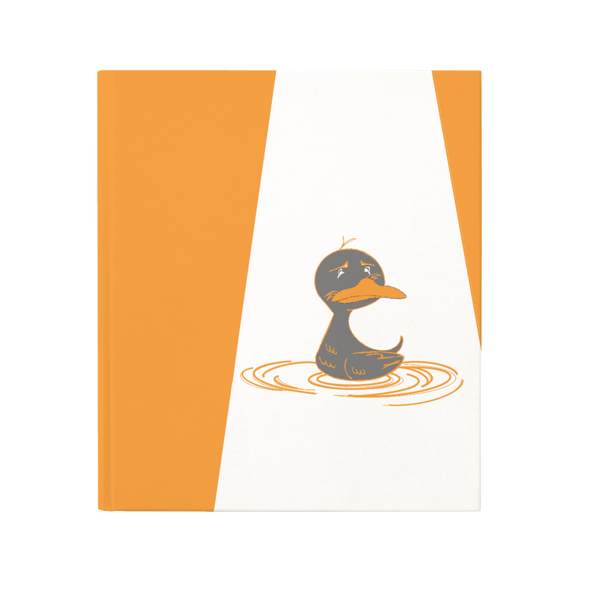
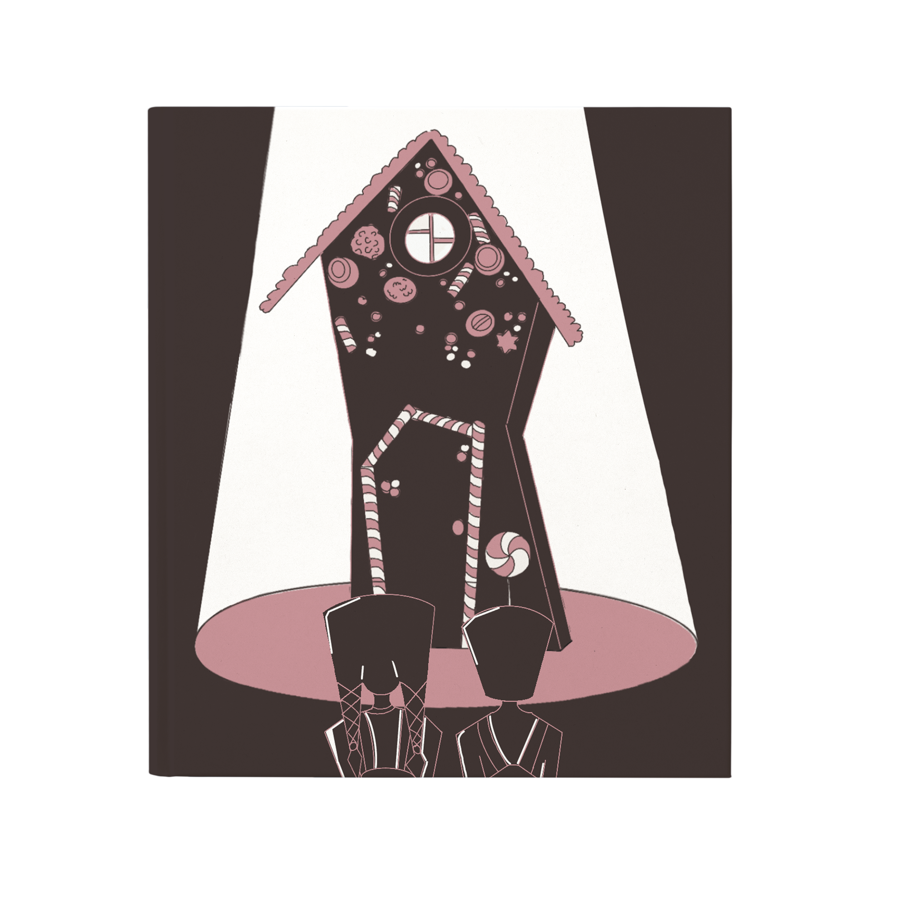
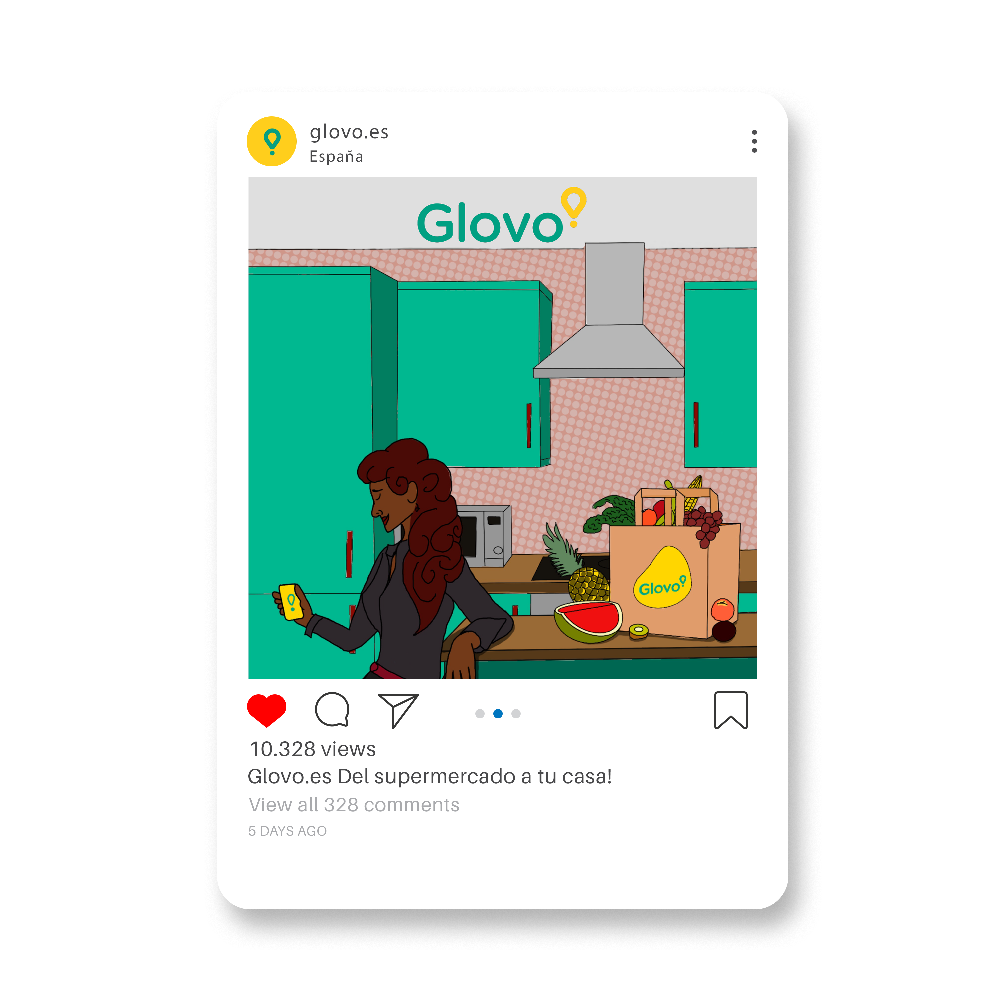
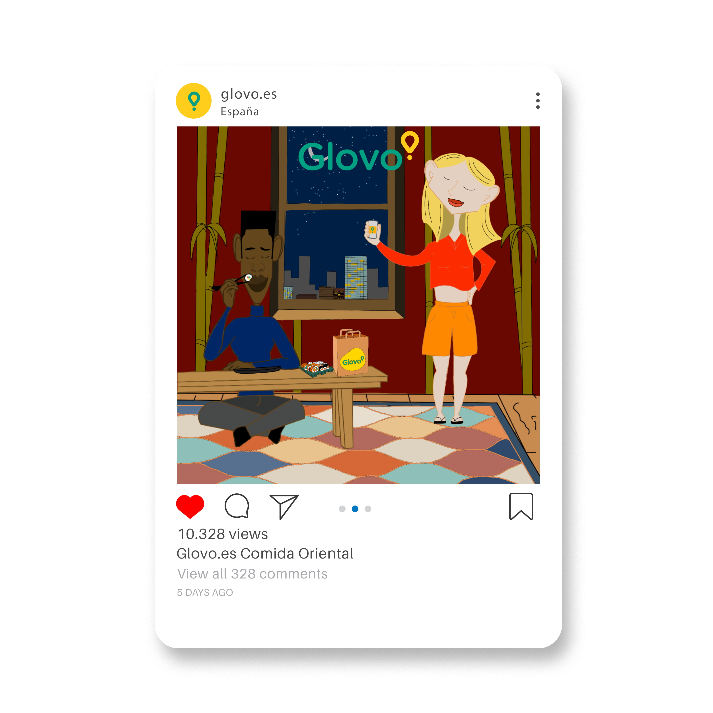
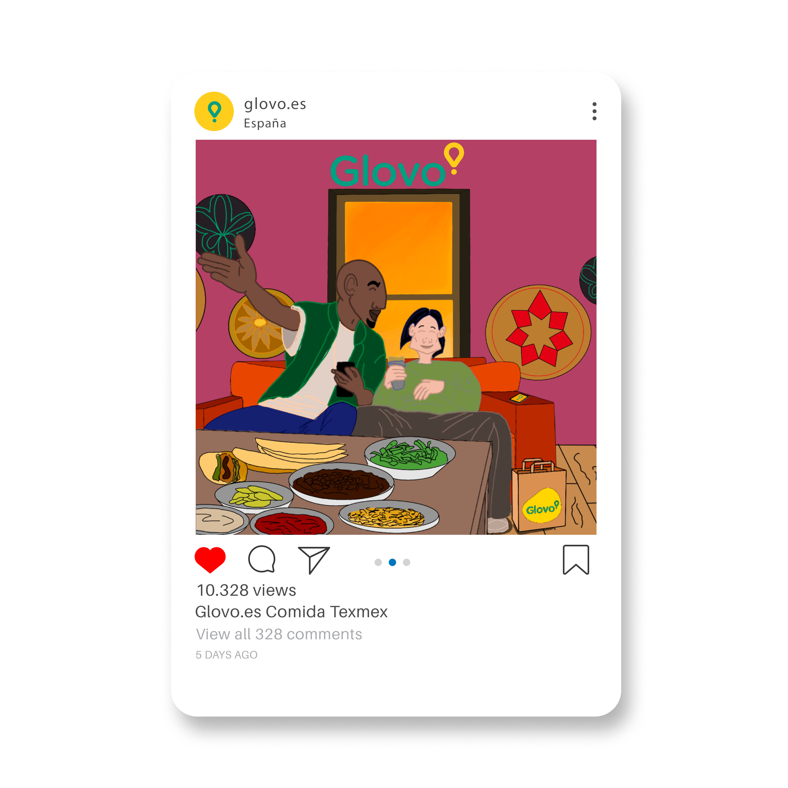

# portfolio
<!-- DENTRO DE SECTION GALERIA EN PROJECTS.HTML -->

                    

                        
                        <h3>Ilustración Infantil. El soldadito de plomo</h3>
                    

                    

                        
                        <h3>Ilustración Infantil. El patito feo</h3>
                    

                    

                        
                        <h3>Ilustración Infantil. Hansel y Gretel</h3>
                    

                

                

                    

                        
                        <h3>Campaña de Glovo. Comida genérica</h3>
                    

                    

                        
                        <h3>Campaña de Glovo. Comida oriental</h3>
                    

                    

                        
                        <h3>Campaña de Glovo. Comida tex-mex</h3>
                    

                

===============================================
-----------------ABOUT ME----------------------
===============================================
 
 Arreglar scroll y hacerlo vertical, animaciones fade out y fade in de los elementos.

 carrusel de imagenes (seccion abilities and skills)

 toggle al final de enlace a contact.html ---> en vez de footer